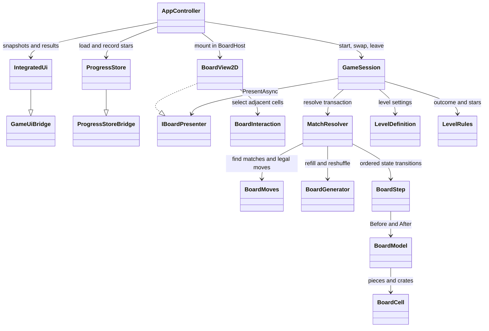
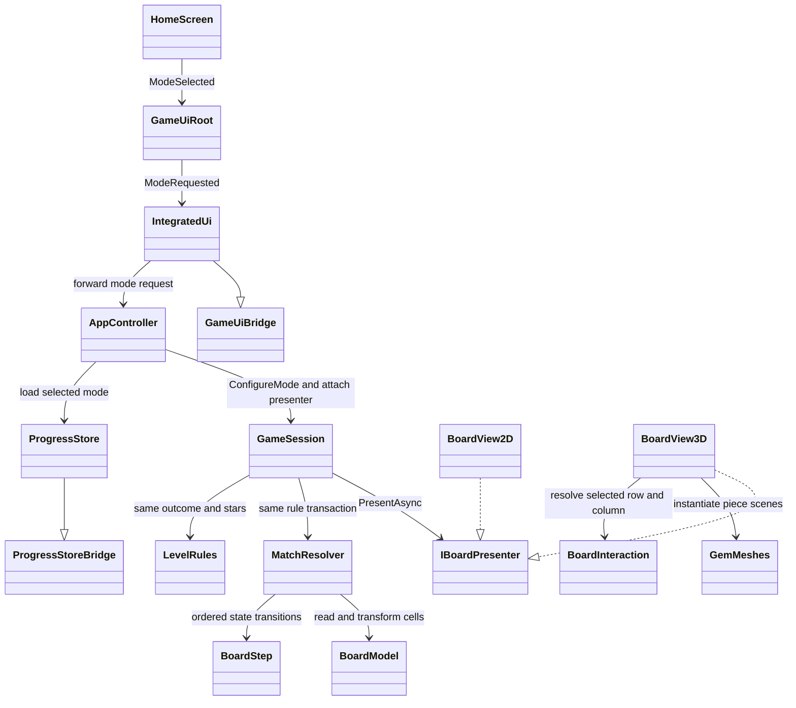

# Colour Block Workshop Class Maps

The 2D map describes `2d-baseline` (`a067c5f`). The 3D map describes the integrated 3D snapshot (`250ae4d`). These maps show the principal classes and their relationships. Node/scene and asset names in the notes identify how the classes are instantiated.

## 2D baseline

`BoardModel` owns the cell grid and validates swaps. A `BoardCell` identifies an empty slot, coloured piece, or crate with a layer count. `LevelDefinition` supplies move budgets, seeds and crate placement. `MatchResolver` computes a `SwapResolution` with ordered `BoardStep` objects. `GameSession` applies those steps, manages the move budget and uses `LevelRules` for the result. `BoardView2D` projects those steps into sprites and animations. `ProgressStore` records the best stars and unlocks.

## 3D final

`AppController` selects the presenter and the progress file in response to the Home mode control. `BoardView3D` owns an orthographic camera and transparent SubViewport, draws the authored Crystal Garden board and uses a camera ray against mesh bounds or the tile plane. `GemMeshes` maps pieces and crate layer counts to PackedScenes. `GameSession.ConfigureMode` records the presentation mode in its snapshot and result data. See the [change map](transition.md) for scope and the metric.
