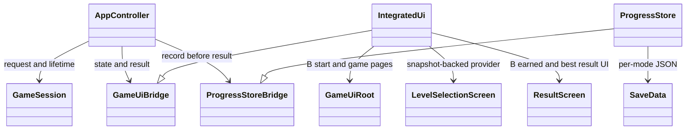

# 正式2D候选的模块接线（2026-11-10）

GameSession通过IBoardPresenter调用BoardView2D，使用MatchResolver/LevelRules/BoardGenerator；纯核心类与布局v2没有改变，完整规则类关系仍见step-5-class-map.md。GameUiRoot原版演示入口只在隔离UI演示下使用；正式导航由IntegratedUi桥接B页面。RuntimeProgressBridge为缺失场景的旧回退，当前正式ProgressStore.tscn存在，正常F5不会挂载它。

B拥有ProgressStore/ResultScreen/设置UI；A保留应用接线和规则。A本轮针对保留坏文件、规范解锁和末关提示修复见联合证据，不把这些更改回写成B原贡献。未实现3D或最终CCR。
