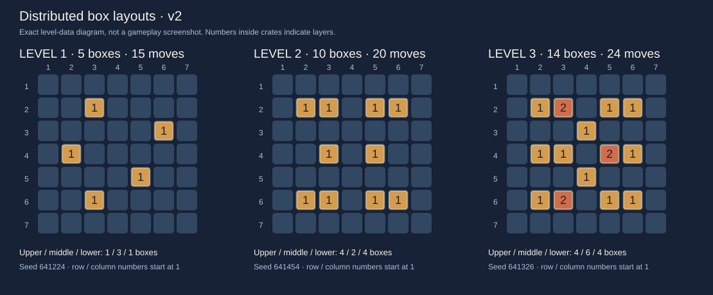

# 三关木箱布局v2：全盘目标与即时破坏反馈

日期2026-11-09（新加坡），成员A @1723358607-rgb。用户实际反馈：“需要消掉的木箱全在底下……消上方方块没有爽感”，随后授权“你来改掉”。本轮在main03d5e66基础上修改；保留本地自动生成的RuleReferenceCheck.cs.uid，不覆盖队友文件。

## 改了什么

木箱从底部箱墙改为分布在上中下区域的孤立目标/小箱群。保留5/10/14箱、第三关3个双层、15/20/24步、邻接伤害与三星算法；没有增加特殊棋子或修改消除规则。第一关5个独立目标分散全盘，第二关成对箱群配通道，第三关加入中部目标和分散双层箱。

| 关卡 | 上/中/下箱数 | 种子 | 示例有效交换 | 通关剩余/星数 |
|---|---|---|---:|---|
| 1 | 1/3/1 | 641224 | 3 | 12步/三星 |
| 2 | 4/2/4 | 641454 | 5 | 15步/三星 |
| 3 | 4/6/4 | 641326 | 8 | 16步/三星 |

上=第1—2行，中=第3—5行，下=第6—7行。行列均从左上角1开始。



原种子配合新布局会出现过早结束（初测L1一手、L2/3两手贪心通关），因此在有界种子扫描后选择新开局；完整候选日志保留。选种标准：三个区域开局都存在直接伤箱的合法交换、没有一手胜利、诊断通关路径长度适合三关演示；不是只为让某个检查变绿。

## 直接反馈证据

以交换所在区域（两格最小行号）分类，统计该交换**第一轮Clear**是否伤箱，不把之后连锁算成立即收益。

| 关卡 | 旧布局上方：可直接伤箱/合法步 | 新布局上方 | 新布局中间 | 新布局下方 |
|---|---:|---:|---:|---:|
| 1 | 0/8 | 6/6 | 4/4 | 1/1 |
| 2 | 1/3 | 1/1 | 7/8 | 1/1 |
| 3 | 2/5 | 3/3 | 3/3 | 1/1 |

每关128种独立随机选步策略，补充RNG与选步RNG分离：新L1通关120/128、L2为118/128、L3为113/128；三星分别105/98/66次。贪心会窥看候选结算，不能冒充真人水平。这版以频繁破坏反馈和宽松入门为主，是否足够爽、节奏是否过快，仍需用户试玩。三关初始均无自动匹配、至少有合法步；全部木箱有几何邻接匹配路线，没有满行/满列箱墙。

## 玩家怎么验收

继续打开同一game/project.godot，停止旧运行，构建C#后F5；重开关卡才会读取新配置。先看木箱是否已分散，再自由消上方，观察目标和木箱层数变化。

想快速验证上方直接伤箱：第一关初始状态，交换第1行第2列↔第2行第2列；顶行组成匹配，其下第2行第3列木箱会受到伤害。要按下面完整通关路径验收，请先重试恢复开局，每次等待连锁结束。

| 关卡 | 有效交换序号 | 点击位置（1开始） | 剩余步数 | 剩余箱 |
|---|---:|---|---:|---:|
| 1 | 1 | 4行3列 ↔ 5行3列 | 14 | 2 |
| 1 | 2 | 6行4列 ↔ 7行4列 | 13 | 1 |
| 1 | 3 | 6行4列 ↔ 6行5列 | 12 | 0 |
| 2 | 1 | 3行7列 ↔ 4行7列 | 19 | 5 |
| 2 | 2 | 5行5列 ↔ 5行6列 | 18 | 5 |
| 2 | 3 | 1行5列 ↔ 2行5列 | 17 | 2 |
| 2 | 4 | 4行5列 ↔ 4行6列 | 16 | 1 |
| 2 | 5 | 6行3列 ↔ 6行4列 | 15 | 0 |
| 3 | 1 | 3行7列 ↔ 4行7列 | 23 | 7 |
| 3 | 2 | 1行3列 ↔ 1行4列 | 22 | 4 |
| 3 | 3 | 2行4列 ↔ 3行4列 | 21 | 3 |
| 3 | 4 | 4行3列 ↔ 4行4列 | 20 | 2 |
| 3 | 5 | 1行3列 ↔ 2行3列 | 19 | 2 |
| 3 | 6 | 4行4列 ↔ 5行4列 | 18 | 2 |
| 3 | 7 | 3行4列 ↔ 4行4列 | 17 | 1 |
| 3 | 8 | 5行2列 ↔ 6行2列 | 16 | 0 |

每局只发布一次结果；通关后检查本次/最佳、下一关、末关无第4关、失败0星及重试。旧第4/5步路径对应旧布局，不再用于当前版本。

## 实际检查与未执行项

Mac arm64、Godot4.7.2.stable.mono.official.ed1daf0bf、.NET SDK10.0.302。C#编译0警告0错误；布局诊断、第0—4步与B原UI演示回归均退出0；真实UI的viewport输入/弹窗/三关胜负/快速点击通过。L3的128局随机测试自然触发1次重排，另保留专用有界死局夹具。

规则参考从实际GameSession/IBoardPresenter重新采集，3个开局、16次有效交换、193个中间步骤，两次完全一致；档案比较工具通过。新档案是layout-v2-rule-reference.json；旧step-5-rule-reference.json和step-4-replays.json保持原样。current-rule-reference.json选择当前档案，避免拿新布局去套旧回放。

图形窗口尝试以返回码-6终止，stdout/stderr为空，未生成新截图；不宣称本轮画面验收通过。图中是严格按配置绘制并校验坐标/数量的SVG示意，不是实机截图。玩家人工图形与爽感验收、声音/导出包本轮未执行。渲染失败与现有无窗口规则/UI检查结果分别记录。

复现（仓库根目录，GODOT指向匹配版本）：

```sh
"$GODOT" --headless --path game --fixed-fps 60 -- --layout-study
"$GODOT" --headless --path game --fixed-fps 60 -- --step4-smoke-test
"$GODOT" --headless --path game --fixed-fps 60 -- --rule-reference
python3 tools/verify-2d-reference.py --godot "$GODOT"
```

--layout-seed-scan须与--layout-study合用，仅用于诊断扫描，不改变正式数据。

## 队友衔接

本轮已发现B正式存档/结果UI的开放PR #10（855fc46），未改写、合并或声称验证它。当前main接线仍为RAM适配器。B接入后需用这里的新关卡和路径重跑，旧第一关两手三星的人工记录不能当作新布局验收。公共目标/步数/result字段及星级算法未改，HUD接口无需变化；请保留双方贡献处理测试文件合并。

本轮只涉及A的关卡、检查入口、证据与文档，没有改B的ui/progress/assets/tests/ui，也未改core或GameSession。没有冻结2D标签，没有开始3D。完整原始AI对话仍待实际导出，本页和价值索引不替代原始记录。
