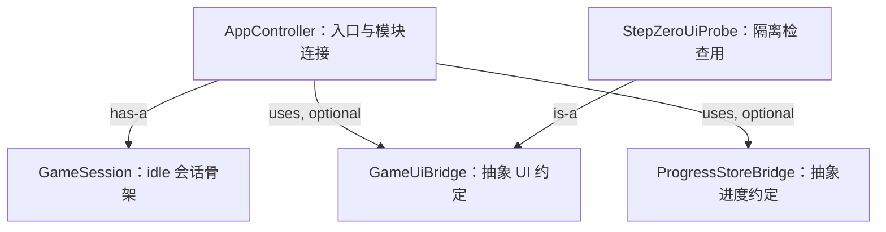

# 第 0 步实际类关系

图中列出当前有行为或公共接口的类。并行初始化已提供 BoardModel、MatchResolver、BoardGenerator、BoardView2D、BoardView3D 空类，本次原样保留；它们尚无棋盘或三消行为，不当作玩法已实现的证明。

- AppController 管应用组合和导航接线，不做匹配规则，不提供正式菜单布局。
- GameSession 当前只维护真实 idle 快照，不创建假棋盘、星级或结算；保留未来唯一的玩法入口。
- GameUiBridge、ProgressStoreBridge 由A提供边界，B在自己目录中继承实现；没有具体B模块时工程仍可启动。
- StepZeroUiProbe 只在显式 --smoke-test 下验证继承信号，正常入口不会挂载。
- 数据用 Dictionary 副本跨边界传递，UI修改快照不会修改会话内数据；引擎表现与未来棋盘核心仍按SPEC分离。
- 取舍：第0步保留可执行边界，不提前设计所有未来玩法类；当前所有快照值为0和idle，不把骨架包装成已完成游戏。
