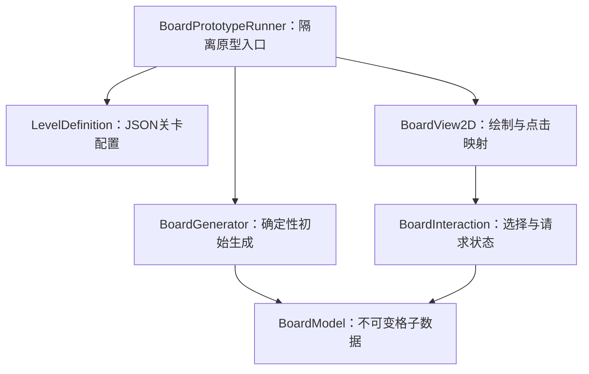

# 第1步实际类关系

BoardCell和GridPosition是与引擎无关的值类型。BoardInteraction只记录通过邻接/可移动性验证的请求，没有执行交换或消除。MatchResolver仍是原有空骨架。

正式GameSession与UI/ProgressStore边界沿用第0步，原型不伪造它们的状态。后续3D可以复用Model、LevelDefinition、生成与交互状态，仅替换绘制/选取适配。
