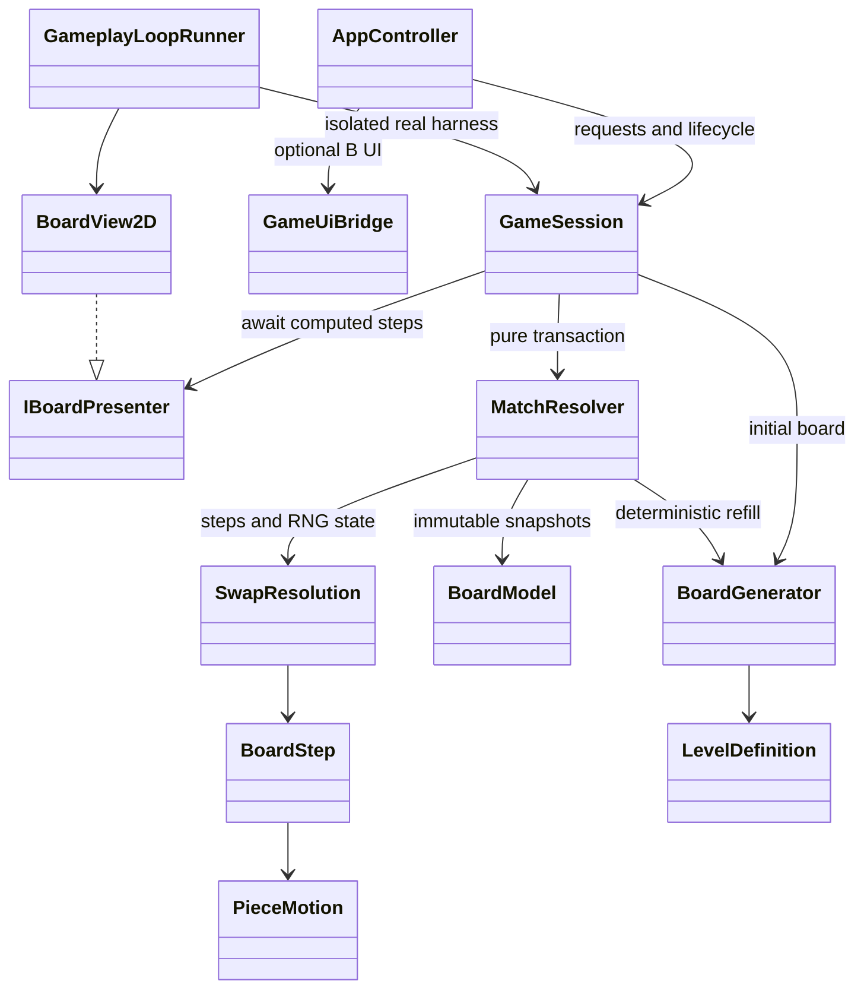

# 第2步实际类关系（A）

2026-11-06。本图对应当前代码，不表示木箱伤害/胜利/3D已经完成。第0/1步类图保留为历史。

BoardModel、BoardCell、GridPosition、LevelDefinition、BoardGenerator、MatchResolver、BoardResolution中的记录均不依赖Godot。GameSession是规则与引擎/信号之间的会话边界；BoardView2D是当前2D适配，后续3D可实现同一个IBoardPresenter并接收相同逻辑步骤。BoardInteraction仍供选择和邻接校验使用。

GameUiBridge/ProgressStoreBridge签名未变；B页面与存档尚未收到。StepTwoUiProbe只是A测试替身，绝不进入生产入口或真实存档。木箱分段下落已实现，邻接伤害、星级、三关配置、死局重排仍按WORKFLOW后续步骤进行。
