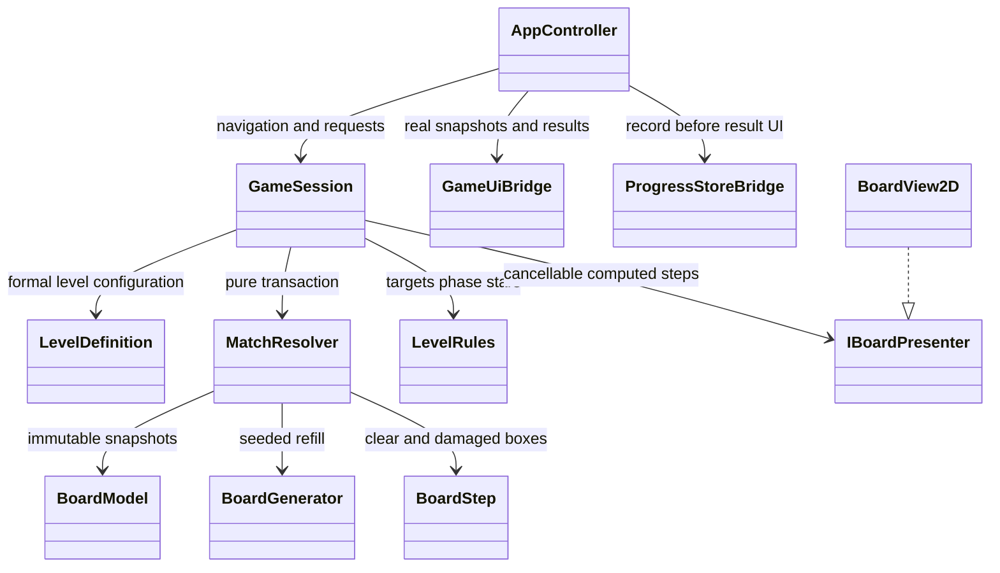

# 第3步实际类关系（草稿）

对应本轮实现；远端复原稿待恢复环境核对。历史第0/1/2步类图保持不变。

LevelRules、MatchResolver、BoardGenerator、BoardModel、LevelDefinition不引用Godot。GameSession拥有唯一结果与生命周期。BoardStep.DamagedBoxes只是表现描述；2D视图不决定伤害或星数。B的公开桥接签名未变。

StepThreeProgressProbe与StepTwoUiProbe只在A隔离检查中使用，没有文件存档，不是B的生产实现。BeginLevel内部组合入口允许检查自定义关卡数据；正式StartLevel只读取三份正式JSON，不提供强制胜利操作。
