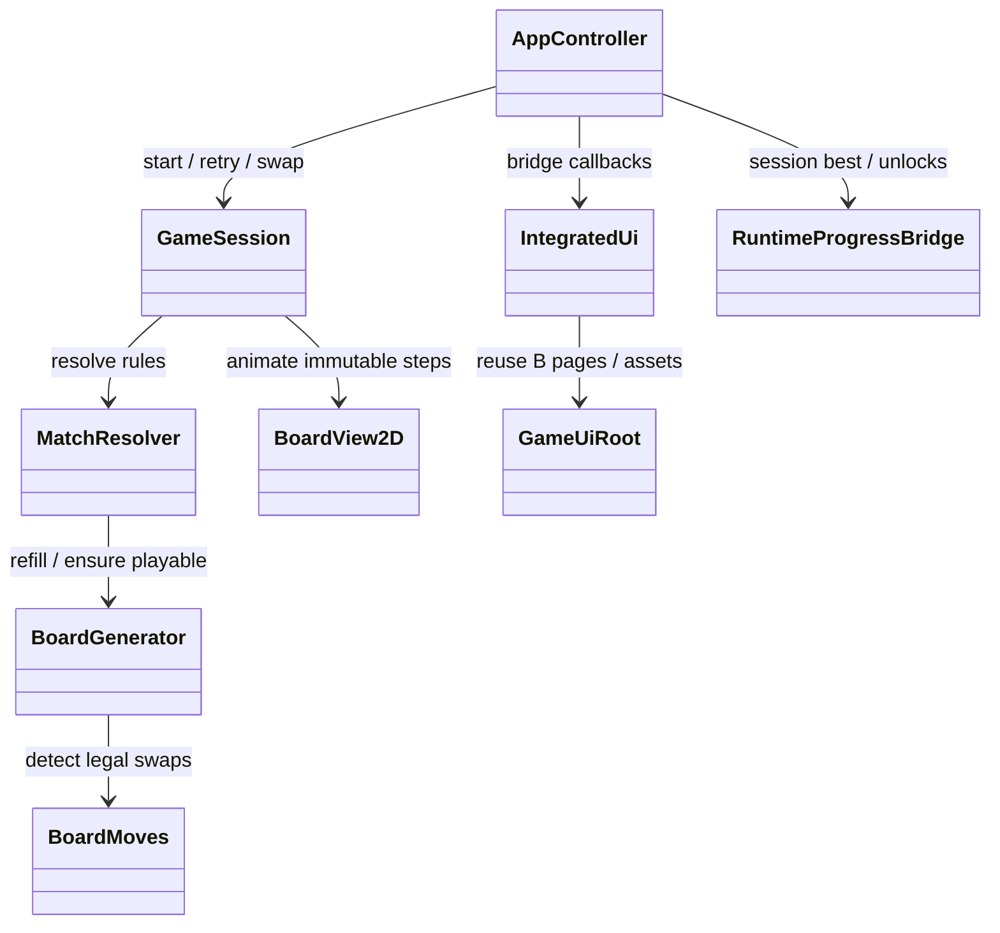

# 第4步类关系（与当前代码一致）

BoardMoves与BoardGenerator、MatchResolver处于纯核心，不读屏幕坐标。BoardView2D使用B的CrystalGardenBoardLayout映射。AppController管理棋盘生命周期与模块接线。IntegratedUi为A-owned临时应用适配器；正式UI和持久化ProgressStore仍属于B。它们不参与匹配、目标或星级算法。

BoardStepKind新增Reshuffle；SwapResolution新增带默认值Reshuffles字段，既有调用兼容。GameSession/Ui/Progress桥接字典字段和信号名未改。
