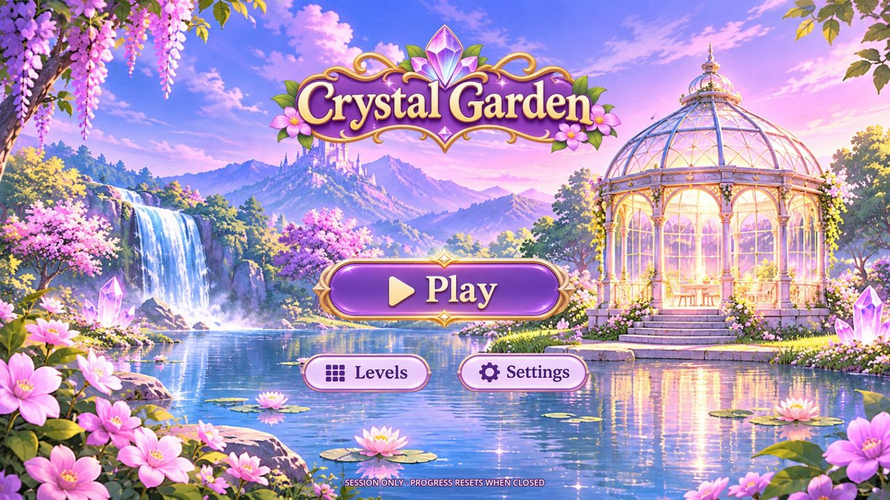
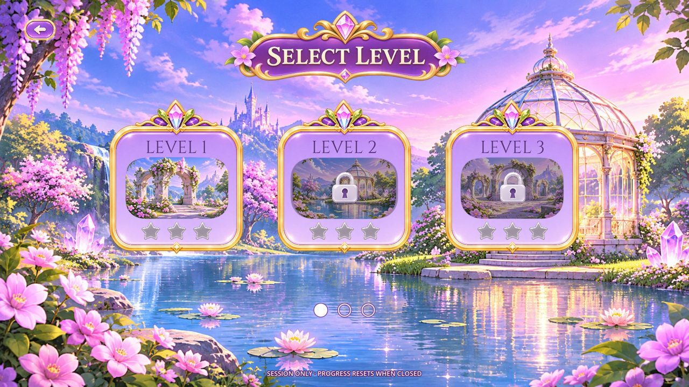
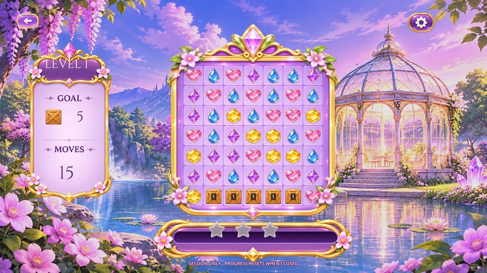
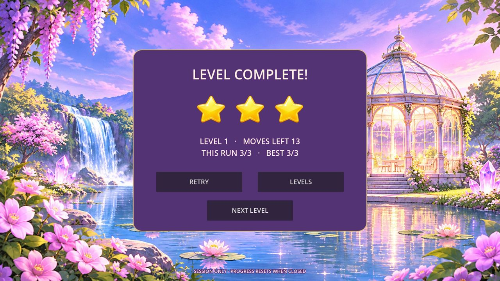

# 第4步：真实 UI 接线、死局恢复与三关跑测

负责人：member-a，@1723358607-rgb。记录：2026-11-08（新加坡）。本轮在 Linux 云端工作副本执行；没有更新或清理用户 Mac 上此前未结束的本地合并。代码提交与 PR 以 GitHub 历史为准。

## 实际完成与贡献边界

- 基线 main `6720b1ea7ce33002c79776cb08cd5502a47a1590`，整合 B 的 `codex/crystal-garden-ui-demo` / PR #5，头 `d280b88865623368afdc4bd09ad5c9349b5c152d`。保留其原始提交和资产，采用双亲合并；不改写其作者、个人分支或归属 PR #7。
- B 的开始/选关/游戏页、素材、字体和测量后的格心布局直接复用。`game/ui/` 文件与 B 原分支一致；BoardView2D 合并保留 B 的贴图/坐标和 A 的木箱层数/受击效果。
- A 新增 `app/integration` 应用适配器，使用真实快照、真实胜负与星数，实现当前运行内的最高星数、解锁及结算页面。不是 B 的正式存档实现，没有写入玩家文件。每页明确显示关闭即清空进度。
- 修复真实页面结构拦截棋盘输入；按钮和离开弹窗仍拦截。49格实际输入映射、快速双击、切页释放、失败/重试/退出均已通过自动真实场景验证。
- 稳定盘面无合法交换时，有界 Fisher–Yates 重排已有普通棋子；不重采样棋子颜色，不改木箱位置/层数/步数/目标。保持确定性 RNG；512次上限，失败抛出明确异常，源棋盘/随机状态不提交。已胜利或最后一步失败不进行无意义重排。
- 新 `BoardMoves` 只检测交换形成的直线匹配，不消耗随机数，不预跑连锁；核心不依赖 Godot 坐标。

## 三关诊断与有依据的改动

每关128种独立的选步随机策略；选步 RNG 与棋盘补充 RNG 分离。贪心策略会窥看完整候选结算，仅用于诊断，不代表真人水平。全部使用实际核心规则。

| 配置 | 随机策略通关 | 随机结果：失败/1星/2星/3星 | 贪心有效步数 | 开局一手通关数 |
|---|---:|---|---:|---:|
| L1 seed641201，15步 | 46/128 | 82/12/18/16 | 2 | 0 |
| L2旧 seed641202，20步 | 70/128 | 58/14/18/38 | 1 | 1 |
| L2新 seed641209，20步 | 48/128 | 80/17/19/12 | 5 | 0 |
| L3 seed641203，24步 | 20/128 | 108/11/3/6 | 9 | 0 |

只将第二关种子641202改为641209，移除已知一手通关开局；未改木箱、15/20/24步预算和星级边界。不能据此声称三关难度严格递增或已经过真人平衡。新L2随机通关率略高于L1，仍需两位玩家试玩评估。

384局最终配置随机模拟没有自然触发重排；重排由专用死局/补充后死局夹具验证，不冒充随机覆盖。第3步旧回放对应旧L2种子，保留为历史证据；当前回放见本页与 step-4-replays.json。

## 自动检查：实际执行

环境：Linux x86_64、Godot `4.7.2.stable.mono.official.ed1daf0bf`、.NET SDK8.0.427，net8.0；与用户 Mac 引擎版本一致，但这不是 Mac 本轮实测。

```sh
cd game
dotnet build AP6412Match3.sln --no-restore -p:NuGetAudit=false -p:UseSharedCompilation=false --disable-build-servers
# 从仓库根目录；GODOT 代表本机匹配版本的可执行文件
"$GODOT" --headless --path game --fixed-fps 60 -- --step4-smoke-test
# 分别替换最后一项重跑既有检查：
# --level-smoke-test / --gameplay-smoke-test / --board-smoke-test / --smoke-test / --ui-smoke-test
"$GODOT" --headless --path game -- --balance-scan
```

| 检查 | 实际结果 |
|---|---|
| 最终 C# 编译 | 通过，0警告0错误 |
| 第4步主入口真实UI | 通过，STEP4_SMOKE_PASS，退出0 |
| 第0/1/2/3步回归 | 均通过，退出0 |
| B原始独立UI演示 | 通过，CRYSTAL_UI_SMOKE_PASS；明确隔离演示数据 |
| 300个开局（3关×100种子） | 无初始匹配、有合法步；全部相邻候选与独立交换+FindMatches枚举一致 |
| 稳定死局夹具 | seed12345，第18次找到解；颜色库存、箱层/目标/步数不变；重复结果一致 |
| 补充后死局夹具 | 4×4，RNG18，1次连锁后追加Reshuffle并恢复可玩 |
| 不可恢复夹具 | 有界8次后明确失败；不改源状态 |
| X11真实窗口/截图 | 通过相同Step4真实UI流程，OpenGL llvmpipe软件渲染，退出0；四页截图已人工查看 |
| 编辑器导入 | 退出0，但GodotTools/MSBuild环境识别发生NullReferenceException，不能标成无错误导入 |

运行日志见 `logs/step4-*.log` 和 `balance-scan.log`。真实窗口环境没有声卡，ALSA初始化ERR_CANT_OPEN后使用Dummy音频；不能据此宣称音效通过。VSync不支持及socket限制另见原日志。没有本轮Mac图形手动验收、队友电脑验收、硬件渲染/声音验收或导出包验证。

## 玩家验收（F5正式入口）

1. 获取完整仓库到新目录（不能只下载 project.godot）。导入 `game/project.godot`，用 Godot Mono4.7.2 构建C#，按F5，看到 Crystal Garden 开始页。当前旧Mac副本有未完成合并，先保留它；不要盲目拉取覆盖。新目录试玩不影响旧副本。
2. Levels进入选关：仅第1关可点，所有星数0，2/3关锁定；Back回开始，Play开第1关。应为15步、5木箱。
3. 第1行第1列↔第1行第2列无效，回退且仍15步。随后可自由玩；要确定通关，重试后按下表操作，每次等待动画结束。坐标均从左上角1开始。
4. 每局结算检查本次/最佳星级；第一关示例剩13步三星。Levels应显示真实三星并解锁第2关；同次进程可重玩，低星或失败不能降低最佳。
5. Next进入下一关；第三关成功显示Garden Complete，不显示第4关。失败显示0星，Retry复位该关。
6. 未结束时点左上返回：取消保持当前局，确认返回选关；弹窗上点击不应消除棋子。快速连点不会重复扣步；进入新关无旧动画或旧结算。
7. 关闭再开会回到0星/仅第1关解锁，这是当前会话内适配器的明确限制；不能作为存档验收通过。

| 关卡 | 第几次有效交换 | 点击位置（行列1开始） | 剩余步数 | 剩余箱 |
|---|---:|---|---:|---:|
| 1 | 1 | 第6行第3列 ↔ 第6行第4列 | 14 | 2 |
| 1 | 2 | 第5行第4列 ↔ 第5行第5列 | 13 | 0 |
| 2 | 1 | 第5行第3列 ↔ 第5行第4列 | 19 | 9 |
| 2 | 2 | 第5行第4列 ↔ 第5行第5列 | 18 | 4 |
| 2 | 3 | 第5行第5列 ↔ 第6行第5列 | 17 | 1 |
| 2 | 4 | 第2行第5列 ↔ 第3行第5列 | 16 | 1 |
| 2 | 5 | 第4行第3列 ↔ 第4行第4列 | 15 | 0 |
| 3 | 1 | 第5行第4列 ↔ 第5行第5列 | 23 | 11 |
| 3 | 2 | 第3行第5列 ↔ 第4行第5列 | 22 | 10 |
| 3 | 3 | 第5行第4列 ↔ 第5行第5列 | 21 | 8 |
| 3 | 4 | 第6行第5列 ↔ 第6行第6列 | 20 | 6 |
| 3 | 5 | 第6行第4列 ↔ 第6行第5列 | 19 | 5 |
| 3 | 6 | 第4行第5列 ↔ 第5行第5列 | 18 | 4 |
| 3 | 7 | 第5行第5列 ↔ 第6行第5列 | 17 | 4 |
| 3 | 8 | 第6行第4列 ↔ 第6行第5列 | 16 | 2 |
| 3 | 9 | 第3行第2列 ↔ 第4行第2列 | 15 | 0 |






## 队友接入与下一步门槛

B继续持有 `ui/`、`progress/`、`tests/ui/`。需要：真实ProgressStore场景、分模式存档、异常文件处理、最高星数/解锁读写；UI原版ShowLevelSelect消费传入progress（移除Demo provider），ShowResult实现真实本次/最佳及Retry/Next/返回信号；保持空白区域事件穿透与弹窗拦截。注意仅增加ProgressStore.tscn会使App切回B原版UI，必须将这些UI改动与存档成套交付后验证，不能只交空存档壳。

建议参考A适配器行为，不能把RAM适配器当持久化；HUD已显示真实剩余步数/箱数，底部星星不是当前局已获星级，目标条由真实已破坏木箱比例驱动。暂停按钮目前隐藏，未约定暂停接口。

未运行：真实存档缺失/损坏/重启读取与2D/3D分文件测试（B尚未提供实现）；两人手动三关验收。尚不满足第5步冻结2D条件；没有创建2d-baseline标签，没有开始3D。

完整原始AI对话：仍待用户从客户端实际导出；本页与价值索引不是原始记录。价值索引：`ai-logs/member-a/index.md`。
