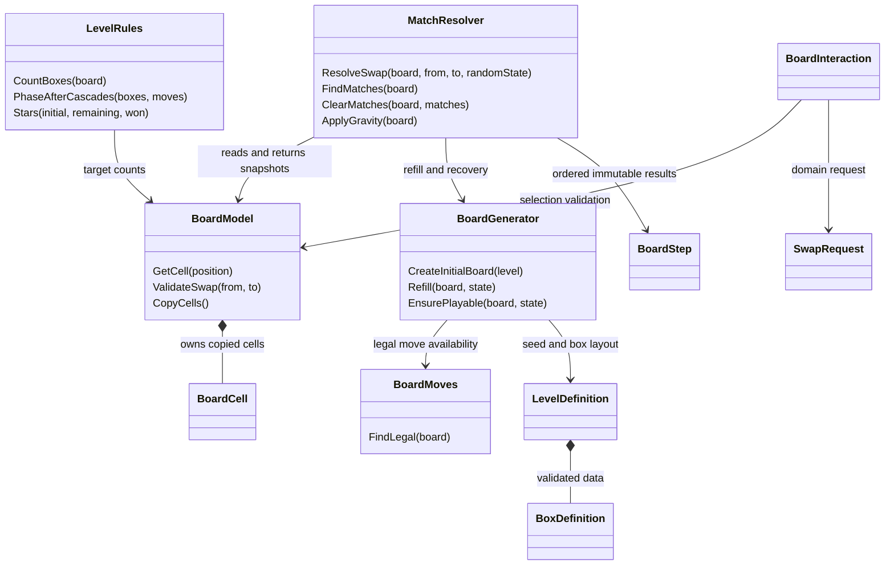
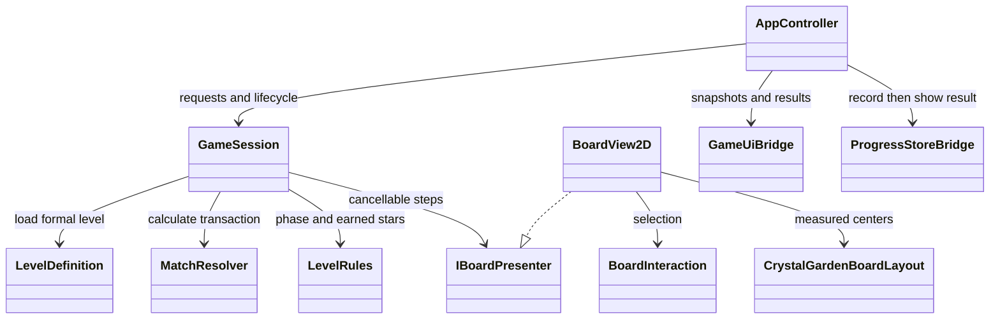
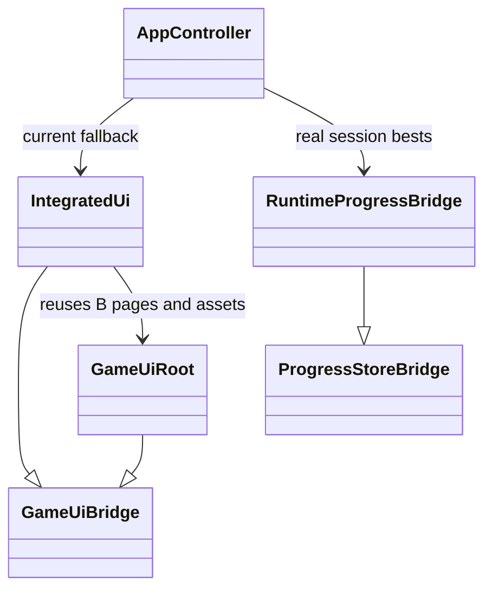

# 第5步玩法类图与职责（当前候选，未冻结）

日期：2026-11-09，新加坡。以实际源码为准，纯核心类型完整清单在 `step-5-source-manifest.json`。当前9个core源文件包含8个class、7个record/record struct、6个enum，共21个公开类型；文件数不是类数。测试辅助类型不混入核心统计。

## 纯规则关系

BoardCell/GridPosition/SwapRequest/PieceMotion为record struct，BoardStep/SwapResolution/ShuffleResult为record。BoardModel复制二维数组，表现层无法改写内部格子。LevelDefinition读取JSON并校验7×7、ID、箱位置和层数；BoxDefinition只承载数据。

## 会话与实际表现

GameSession继承Godot.Node，持有本局步数、RNG、phase和取消令牌；它不属于完全脱离引擎的纯core。当前snapshot.mode固定为2d，3D时若需要改为配置字段，必须记录真实改动，不能为了声称零变更而隐瞒。

IBoardPresenter不包含Node/Vector接口，仅消费核心坐标和BoardStep。BoardView2D将输入转换成行列，播放步骤；不自行判匹配或发星。CrystalGardenBoardLayout是B提供的视觉坐标适配，不能移入纯规则层。

## 当前应用接线与未完成项

IntegratedUi与RuntimeProgressBridge属于A的应用适配器，不是B的正式持久化。实际ProgressStore实现尚不存在；图中不伪画已完成的存档类。GameUiRoot属于B，当前原版选关/结算仍需接线。

BoardView3D目前是隐藏的空Node3D骨架，没有实现三维棋盘、拾取或动画；不作为已完成3D证据。RuleReferenceCheck及其RecordingPresenter只在测试命令下运行，不在正式玩法中替玩家操作。
