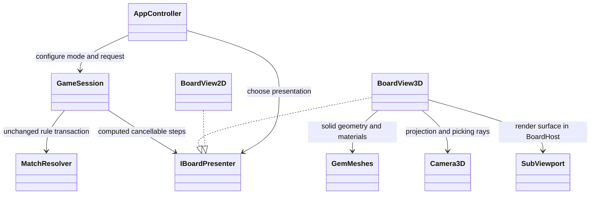

# 当前3D试作类关系与改动（2026-11-10）

IBoardPresenter和纯core签名未改；GameSession新增模式配置，AppController把同一模式传给ProgressStore。UI桥接签名、ResultScreen、ProgressStore实现与2D联合候选一致，snapshot/result.mode现在随应用入口正确为2d/3d。

| 路径 | 实际变化 |
|---|---|
| core/、data/levels/ | 与2D对照无差异 |
| gameplay/GameSession.cs | 增加Mode/ConfigureMode，快照不再固定2d |
| app/AppController.cs | 按模式接线、3D表面生命周期、模式标识和测试入口 |
| presentation/3d/BoardView3D.cs | 从空骨架实现IBoardPresenter、3D视图、射线和动画 |
| presentation/3d/GemMeshes.cs | 新增纯表现几何与材质 |
| app/Main3D.tscn / project.godot | 新3D入口；该分支F5默认3D；旧Main仍为2D |
| ui/、progress/、assets/、app/integration/ | 原样复用 |
| tests/gameplay/StepSixSmokeCheck.cs | 实际3D交互、规则档案对比、UI/存档/取消检查 |

不是最终类图或CCR结论；2D正式冻结和人工3D图像验收仍待补。
